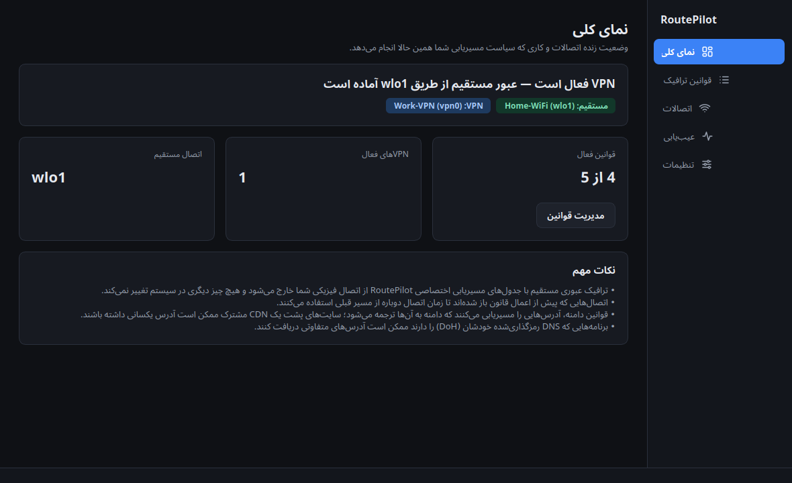

<div dir="rtl">

# RoutePilot (روت‌پایلت)

**تونل‌زنی تفکیکی (Split Tunneling) برای لینوکس دسکتاپ** — دامنه‌ها و رنج‌های IP دلخواه را بدون
خاموش کردن VPN از کنار آن عبور دهید، یا آن‌ها را مجبور کنید فقط از یک VPN مشخص بروند.

[English README](README.md)

<p align="center"></p>

وقتی VPN تمام ترافیک را از تونل عبور می‌دهد، سایت‌هایی مثل بانک‌ها و درگاه‌های داخلی که IP خارجی
را مسدود می‌کنند یا سرویس‌های شبکه محلی از دسترس خارج می‌شوند. RoutePilot فقط همان مقصدها را از
اینترنت مستقیم عبور می‌دهد و بقیه ترافیک همچنان از VPN می‌رود. این کار با مسیریابی خود هسته لینوکس
انجام می‌شود؛ بدون پراکسی، بدون TUN اضافه و بدون سرویس دائمی در پس‌زمینه.

## امکانات

- قانون بر اساس **دامنه، دامنه و زیردامنه‌ها، آدرس IP یا رنج CIDR** (IPv4 و IPv6)
- عملکردها: **مستقیم (عبور از کنار VPN)**، **فقط از طریق VPN** (حتی یک VPN مشخص)، **مسدودسازی**
  و **پیش‌فرض سیستم**
- **حالت امن (Fail-Closed) به‌صورت پیش‌فرض:** اگر مسیر انتخابی قطع شود، ترافیک مسدود می‌شود و
  بی‌صدا از مسیر دیگری نشت نمی‌کند — این را خود هسته لینوکس اعمال می‌کند
- **Split DNS:** دامنه‌ها از طریق DNS همان اتصالی که ترافیک از آن می‌رود ترجمه می‌شوند
- سازگار با VPNهای NetworkManager (OpenVPN، WireGuard، IPsec)، wg-quick و کلاینت‌های حالت TUN مثل
  sing-box، clash/mihomo و رابط‌های v2ray/xray (مثلاً Hiddify، Nekoray)
- فقط جدول‌های مسیریابی و جدول nftables خودش را تغییر می‌دهد و به ufw، firewalld یا Docker دست نمی‌زند
- رابط کاربری بدون دسترسی root اجرا می‌شود؛ تغییرات پس از تأیید رمز مدیر سیستم (polkit) اعمال می‌شوند
- بازنشانی کامل با یک کلیک یا دستور `routepilot reset`
- رابط واکنش‌گرا، تم تیره/روشن/مطابق سیستم، **فارسی کامل با چیدمان راست‌به‌چپ**

## نصب

پیش‌نیازها: Python نسخه ۳.۱۱ یا بالاتر، nftables و polkit (برنامه `pkexec`).
NetworkManager توصیه می‌شود و systemd-resolved برای Split DNS لازم است.

</div>

```bash
# Debian / Ubuntu
sudo apt install git python3 python3-venv nftables pkexec

git clone https://github.com/pedramkhademi619/routepilot.git
cd routepilot
./scripts/install_desktop.sh
```

<div dir="rtl">

پس از نصب، RoutePilot در منوی برنامه‌ها قرار می‌گیرد. برای به‌روزرسانی، بعد از `git pull` همین
اسکریپت را دوباره اجرا کنید و برای حذف از `--uninstall` استفاده کنید.

## استفاده

۱. به بخش **قوانین ترافیک** بروید و روی **قانون جدید** بزنید.
۲. دامنه (مثلاً `mybank.example`)، آدرس IP یا رنج را وارد کنید و عملکرد **مستقیم (عبور از کنار VPN)**
   را انتخاب کنید.
۳. ذخیره کنید. سیاست بلافاصله اعمال می‌شود و سیستم رمز مدیر را می‌پرسد.
۴. در بخش **عیب‌یابی** می‌توانید ببینید ترافیک هر مقصد از کجا می‌رود.

اگر اتصال اینترنت مشکل پیدا کرد: **تنظیمات ← بازنشانی وضعیت شبکه** یا دستور `routepilot reset`.
قوانین ذخیره‌شده شما حذف نمی‌شوند. برای امتحان بدون هیچ تغییری در سیستم: `routepilot-gui --mock`

</div>

```bash
routepilot status               # اتصالات، VPNها و اتصال مستقیم
routepilot eval mybank.example  # کدام قانون اعمال می‌شود و ترافیک از کجا می‌رود
routepilot plan                 # پیش‌نمایش تغییرات بدون اعمال
routepilot apply                # اعمال سیاست (با تأیید رمز مدیر)
routepilot reset                # حذف همه تغییرات RoutePilot
```

<div dir="rtl">

## نکات مهم

- مسیریابی بر اساس IP انجام می‌شود؛ سایت‌هایی که پشت CDN مشترک هستند ممکن است IP یکسانی با سایت‌های
  دیگر داشته باشند. اگر سایتی هنوز از VPN می‌رود، با `routepilot plan` آدرس‌های ترجمه‌شده را ببینید و
  برای دامنه‌های دیگری که سایت از آن‌ها استفاده می‌کند هم قانون بسازید.
- DNS داخلی مرورگرها (DoH) را برای نتیجه یکسان غیرفعال کنید.
- اتصال‌هایی که قبل از اعمال قانون باز شده‌اند تا اتصال دوباره از مسیر قبلی می‌روند.
- مسیرهای هسته با ری‌استارت پاک می‌شوند؛ بعد از ورود به سیستم روی **اعمال روی سیستم** بزنید.

جزئیات فنی بیشتر، معماری و پرسش‌های متداول در [README انگلیسی](README.md) آمده است.

## مشارکت

گزارش مشکل، ترجمه و Pull Request با کمال میل پذیرفته می‌شود — [CONTRIBUTING.md](CONTRIBUTING.md)

## مجوز

نرم‌افزار آزاد تحت مجوز [GPL-3.0-or-later](LICENSE).

</div>
