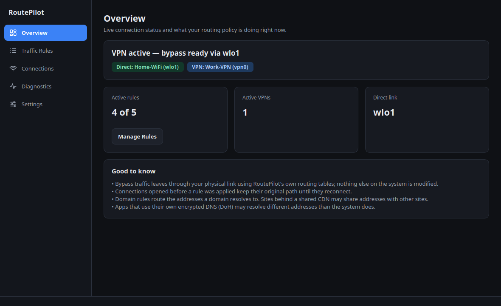
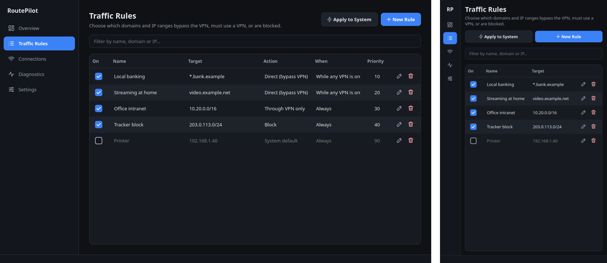
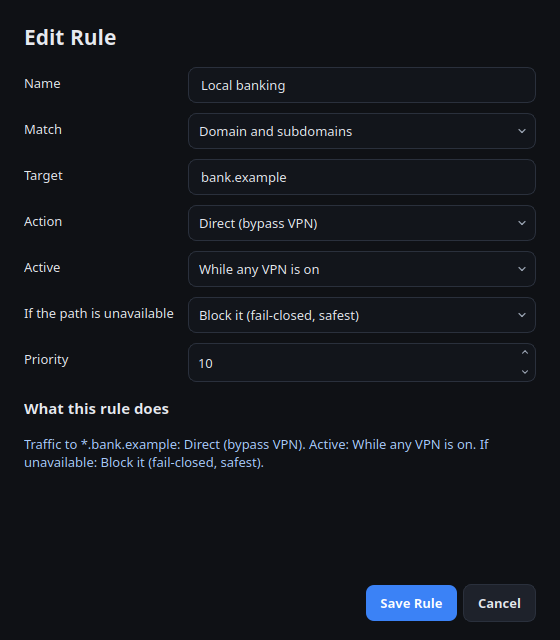
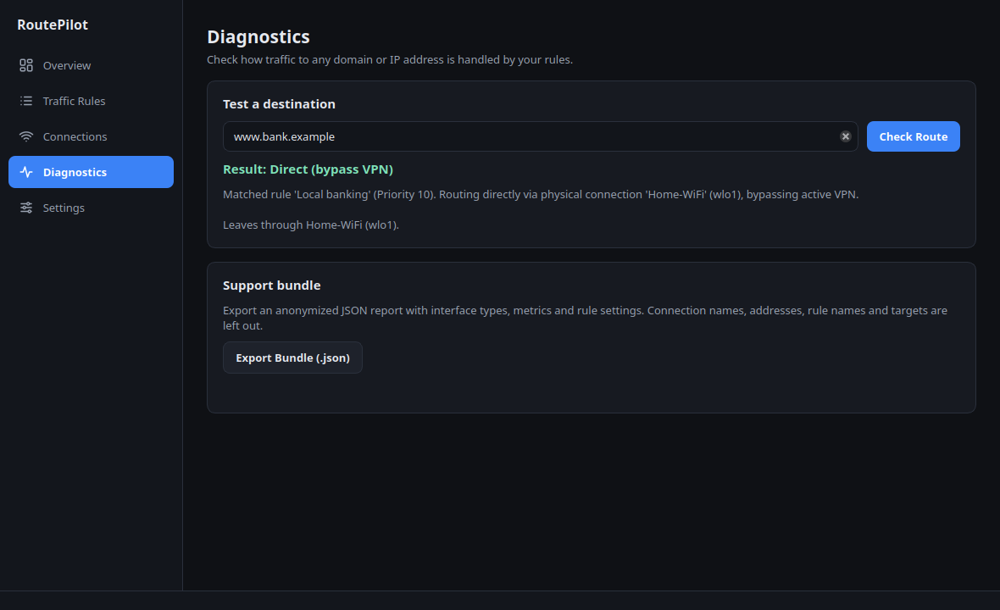
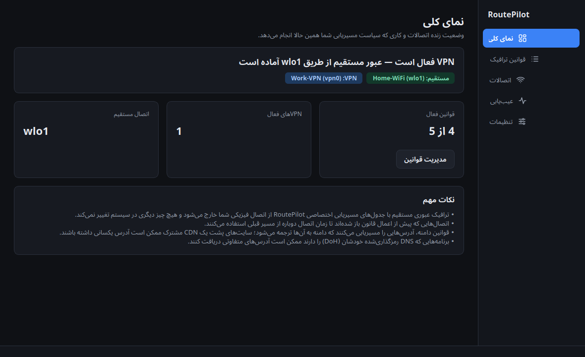
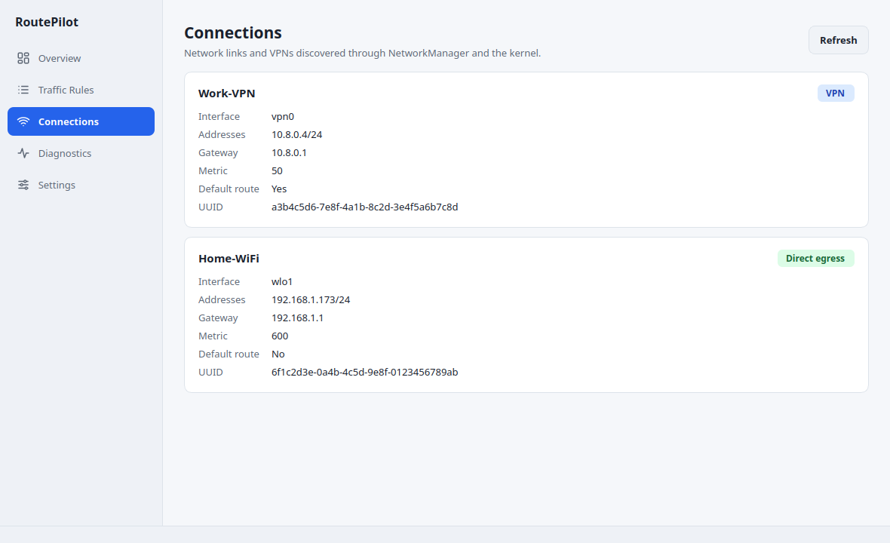
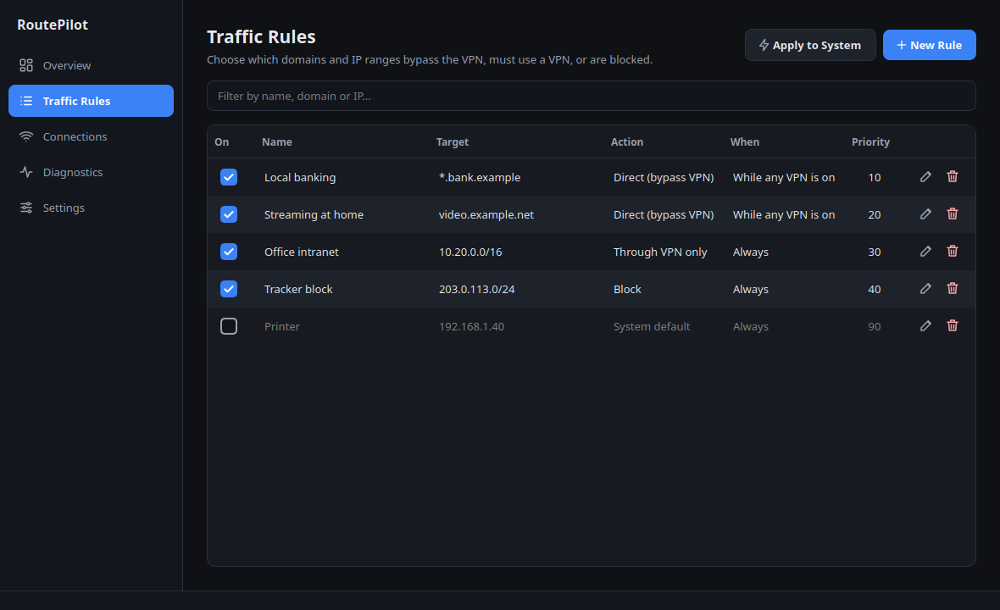
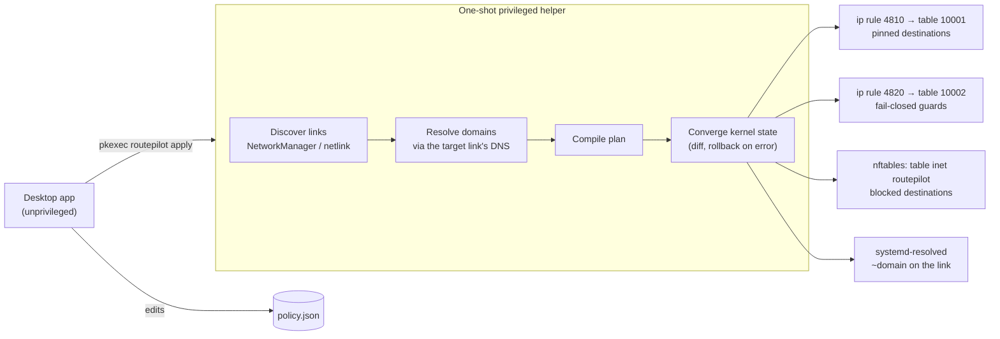

<div align="center">


# RoutePilot

**Split tunneling for Linux desktops.**
Send chosen domains and IP ranges *around* your VPN — or force them *through* a specific one —
without turning the VPN off.

[](https://github.com/pedramkhademi619/routepilot/actions/workflows/ci.yml)
[](LICENSE)


[Features](#features) · [Install](#installation) · [Usage](#usage) · [How it works](#how-it-works) · [FAQ](#faq) · [فارسی](README.fa.md)



</div>

---

With a full-tunnel VPN on, everything leaves through the tunnel — including the local bank that
blocks foreign IPs, the streaming service that wants your home country, or the office printer.
RoutePilot lets you carve out exactly those destinations while the rest of your traffic stays
in the VPN. It uses the kernel's own policy routing: no proxy, no extra TUN device, no background
daemon, and it works next to the VPN client you already use.

## Features

- **Rules by domain, domain + subdomains, IP address or CIDR range** (IPv4 and IPv6).
- **Actions:** *Direct* (bypass the VPN), *Through VPN only* (optionally a specific VPN),
  *Block*, or *System default* to carve exceptions out of broader rules.
- **Fail-closed by default, enforced by the kernel:** if the chosen path disappears, matching
  traffic is refused instead of silently leaking somewhere else.
- **Split DNS:** domains are resolved through the DNS servers of the link they will use, and
  `systemd-resolved` routing domains keep applications resolving the same addresses.
- **Plays well with others:** NetworkManager VPNs (OpenVPN, WireGuard, IPsec), wg-quick, and
  TUN-mode clients such as sing-box, clash/mihomo and v2ray/xray front-ends. RoutePilot only
  touches its own routing tables and its own nftables table — never `ufw`, `firewalld` or Docker.
- **Safe by design:** the GUI runs unprivileged; changes are applied by a one-shot helper after
  polkit authorization. Applying is idempotent, failures roll back completely, and one click
  (or `routepilot reset`) removes everything.
- **Diagnostics:** ask "where would traffic to *x* go and why?", export an anonymized support bundle.
- **Polished desktop app:** responsive layout down to 480 px, dark / light / follow-system themes,
  English and Persian (full right-to-left support), tray icon.
- **Scriptable CLI:** `status`, `rules`, `eval`, `plan` (dry run), `apply`, `reset`.

## Screenshots

| Traffic rules — desktop and narrow window | Rule editor |
| :-: | :-: |
|  |  |
| **Diagnostics** | **Persian (right-to-left)** |
|  |  |
| **Light theme** | **Rules** |
|  |  |

## Installation

### Requirements

- A Linux distribution with Python **3.11+**, **nftables** and **polkit** (`pkexec`).
- **NetworkManager** is recommended (other setups fall back to plain netlink discovery).
- **systemd-resolved** is optional and enables split DNS.

```bash
# Debian / Ubuntu
sudo apt install git python3 python3-venv nftables pkexec      # older releases: policykit-1
# Fedora
sudo dnf install git python3 nftables polkit
# Arch Linux
sudo pacman -S git python nftables polkit
```

### From source (desktop integration)

```bash
git clone https://github.com/pedramkhademi619/routepilot.git
cd routepilot
./scripts/install_desktop.sh
```

This creates a virtual environment inside the checkout, links `routepilot` and `routepilot-gui`
into `~/.local/bin`, and adds RoutePilot to your application menu. Run the script again after
`git pull` to update; remove it with `./scripts/install_desktop.sh --uninstall`.

### With pipx

```bash
pipx install git+https://github.com/pedramkhademi619/routepilot.git
routepilot-gui
```

## Usage

### Desktop app

1. Open **Traffic Rules → New Rule**.
2. Enter a domain (e.g. `mybank.example`), an IP or a CIDR range, and choose an action —
   usually **Direct (bypass VPN)**.
3. Save. RoutePilot applies the policy right away; your desktop asks for an administrator
   password (polkit) to change the routing tables.
4. Use **Diagnostics** to check where a destination goes, and **Connections** to see what
   RoutePilot detected.

If anything ever looks wrong: **Settings → Reset Network State** (or `routepilot reset`). Your
saved rules are kept. Try it risk-free with simulated connections: `routepilot-gui --mock`.

### Command line

```bash
routepilot status               # connections, VPNs and the direct link
routepilot rules                # configured rules
routepilot eval mybank.example  # which rule wins, and where traffic goes
routepilot plan                 # dry run: routes, ip rules, split DNS and nftables
routepilot apply                # apply the policy (asks for authorization)
routepilot reset                # remove everything RoutePilot installed
```

Rules are stored in `~/.config/routepilot/policy.json`:

```json
{
  "schema_version": 1,
  "updated_at": "2026-11-21T10:00:00+00:00",
  "rules": [
    {
      "name": "Local bank",
      "priority": 10,
      "selector": { "type": "domain_and_subdomains", "value": "mybank.example" },
      "action": { "type": "use_direct" },
      "condition": { "type": "any_vpn_active" },
      "fallback": { "behavior": "block" }
    }
  ]
}
```

## How it works



Every packet's route lookup walks the routing policy database in priority order. RoutePilot's
two rules run first (before VPN clients such as sing-box at `9000` or wg-quick at `32764`):

| Priority | Table | Contents |
| :-- | :-- | :-- |
| 4810 | `10001` | `via <gateway> dev wlo1` for bypassed destinations, `dev <vpn>` for "VPN only", `throw` for "system default" |
| 4820 | `10002` | `unreachable` guards for fail-closed rules |

Destinations without a route in those tables fall through to your normal routing untouched.
Because the decision happens during the regular lookup, the kernel also picks the right source
address — no NAT involved. If your Wi-Fi drops, its routes vanish from `10001` and the guard in
`10002` refuses the traffic instead of letting it slip into the VPN or anywhere else.

Inspect it yourself:

```bash
ip rule show
ip route show table 10001
ip route get 203.0.113.7
sudo nft list table inet routepilot   # only exists when you have Block rules
```

More background: [ADR 0006 — destination override tables](docs/adr/0006-destination-override-tables.md),
[threat model](docs/security/threat_model.md),
[capabilities and limits](docs/capabilities/capability_matrix.md).

## FAQ

**A site still goes through the VPN.**
Run `routepilot plan` and check that the domain resolved to addresses. Sites behind large CDNs
load assets from other host names — add rules for those too (or the provider's CIDR ranges).
Browsers with built-in DNS-over-HTTPS may use different addresses; disable it for consistent
results. Connections opened before applying keep their old path until they reconnect.

**Does it work with my VPN?**
Most likely, if it creates a network interface: NetworkManager VPNs, WireGuard, OpenVPN and
TUN-mode proxy clients all work. VPN apps with a strict kill-switch firewall (e.g. Mullvad,
Proton) block bypass traffic by design — use their built-in split tunneling instead.

**Does RoutePilot run as root?**
No. Only `routepilot apply` / `reset` run as root, briefly, after polkit authorization.

**Is anything sent anywhere?**
No telemetry. The only network traffic RoutePilot creates is DNS lookups for your own rules.

**Will my rules survive a reboot?**
Your rules do; kernel routes don't (by design). After login, click **Apply to System** in
RoutePilot or run `routepilot apply`. Automatic re-apply is on the roadmap.

## Roadmap

- [ ] Background service: re-apply on network changes and DNS TTL expiry
- [ ] Per-application routing (cgroup v2 scopes)
- [ ] Distribution packages (Debian/Ubuntu, Fedora, AUR)
- [ ] Rule import/export and presets
- [ ] More translations — [help wanted](CONTRIBUTING.md#translations)

## Contributing

Bug reports, translations and pull requests are welcome — see [CONTRIBUTING.md](CONTRIBUTING.md).
The test suite includes an integration test that drives the real netlink and nftables code inside
a disposable network namespace, so you can work on the routing engine without root.

Please report security issues privately as described in [SECURITY.md](SECURITY.md).

## License

RoutePilot is free software, released under the
[GNU General Public License v3.0 or later](LICENSE).
